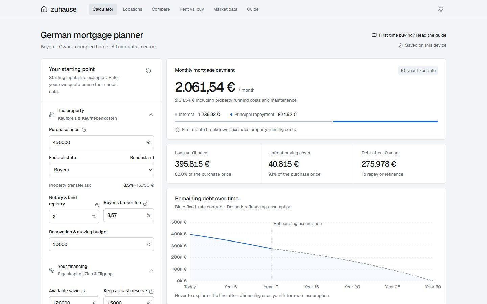

# Zuhause

A Bavaria-first, open-source German mortgage and property research workbench. Understand the whole purchase, test the years ahead and trace the numbers back to their sources.

Built with React, TypeScript and Vite. Static hosting, no account, backend, analytics, API keys or paid provider required. English explanations retain the German financing terminology.

[Open the app](https://mohamedadel104.github.io/custom-mortgage-calc/)



## What it does

- Owner-occupied annuity mortgage calculations, with transfer tax in all 16 federal states.
- Notary/registry allowance, buyer-side commission, renovation and a separate cash reserve.
- Monthly amortization, first-payment breakdown, fixed-period residual debt and annual special repayments.
- Refinancing assumptions, target payoff term, rate stress tests and household affordability.
- Three saved scenarios, JSON import/export and monthly repayment CSV export.
- Rent versus buy with investment of the cash-flow difference on both paths.
- Town/postcode search through OpenPLZ; explicitly choose a result to apply the correct state tax.
- Default research focus: apartments in 81245 / Neupasing. The Paul-Gerhardt-Allee overview starts with the municipality’s ≈2,400 homes and ten project/subset records, including 295 developer-reported sold/handed-over apartments and a separate 68-home block acquisition. Housing stock, sales claims and transaction evidence stay distinct.
- Fourteen individual apartment references (four with displayed prices) and five secondary house references retain original sources. Apartment details include rooms, Baujahr, Hausgeld periods, extra parking and leasehold charges where disclosed. Missing closing prices and sale dates stay missing. Three dated 2017 project asking-price ranges have publication-month mortgage context.
- Historical German mortgage conditions from 2003, with year/fixation filters, monthly observations and coverage-aware period averages beside citywide Munich price summaries.
- Munich half-year purchase-price samples for eight segments, with 2024, corrected 2025 and 2026 original reports.
- On-demand embed of Bavaria's official regional market dashboard, plus BORIS and local committee resources.
- National transaction-price history since 2015 from Eurostat / Destatis, including provisional flags.
- Official NRW residential reference records, with selected historical summaries. Of 386 source municipality codes, 381 are displayed; five conflicting location labels are withheld.
- Your own local comparable-evidence ledger: asking prices and documented sales stay separate, with location/type/date filters, source links and backups.
- A plain-language mortgage guide and device-local buying checklist.

This does not provide a complete address-level German transaction database or a bank's personalized offer. Local evidence has variable coverage; an index, reference value, asking price and completed sale are explicitly different things.

## Run locally

Use Node **22.12 or newer** (latest Node 22 LTS recommended).

```sh
npm ci
npm run dev
```

```sh
npm test
npm run build
npm run preview
```

The calculator works from retained snapshots when upstream data services are unavailable. External location searches need connectivity. Financial inputs and user evidence are stored in browser localStorage, subject to browser policy; use the export functions to back them up. Private browsing and clearing site data can erase them.

## Hosting on GitHub Pages

`.github/workflows/pages.yml` tests, builds and deploys pushes to `main` using the repository's actual name as Vite's base path. The intended project address for this repository is `https://mohamedadel104.github.io/custom-mortgage-calc/`.

The repository's Pages source must be **Settings → Pages → Build and deployment → GitHub Actions**. It is configured for the original repository; forks must select it once, then run **Publish GitHub Pages**. This is deployment configuration, not an application backend. A custom domain needs `BASE_PATH=/` and its own domain/DNS setup.

Forks must enable Pages and Actions themselves. GitHub can disable scheduled workflows on inactive public repositories; monitor Actions and manually rerun data refresh after re-enabling them.

## Updating the evidence

```sh
npm run data:update
node scripts/update-prices.mjs
node scripts/update-nrw.mjs
```

The daily Actions job checks official ECB rates and Eurostat prices. A monthly job checks NRW files. Imports validate schema, dimensions and values before replacing a retained snapshot; unchanged observations do not create new data commits. Scheduled data commits use `GITHUB_TOKEN`, so that workflow explicitly deploys its artifact rather than relying on a push-triggered workflow.

Taxes, rules, Bavarian source links and the selected Munich report extracts are **manually reviewed**, with dates shown in the UI. They are not silently advertised as automatically updated. See [DATA_SOURCES.md](DATA_SOURCES.md) for the coverage, rights, provenance and maintenance process, and [docs/CALCULATIONS.md](docs/CALCULATIONS.md) for reproducible formulas and exclusions.

## Project map

```text
src/lib/                 Pure calculations, validation and local storage
src/components/          Forms, charts and financing results
src/pages/               Location, comparison, rent/buy, market and guide views
src/data/                Reviewed state taxes, source links and Munich factual extracts
scripts/                 Validated official data importers
public/data/             Dated, reproducible source snapshots
design/                  Taste skill, direction and design review notes
.github/workflows/       Tests, hosting and data refresh
```

## Design and contributions

The repo includes the requested [Taste skill](https://github.com/Leonxlnx/taste-skill) under `design/skills/design-taste-frontend`. Its app-screen workflow drives the design: Achromatic ledger, seed `857519272`, locally hosted Geist, subdued chrome, tabular figures and the fixed-rate/refinancing boundary as the central visual device. Read [design/DESIGN.md](design/DESIGN.md) before changing the interface. The vendored skill is read directly for this project; it is not a global Codex installation.

See [CONTRIBUTING.md](CONTRIBUTING.md). Code is MIT-licensed. Upstream datasets, fonts, municipal publications and the Taste skill retain their own terms; the MIT license does not relicense those materials.
